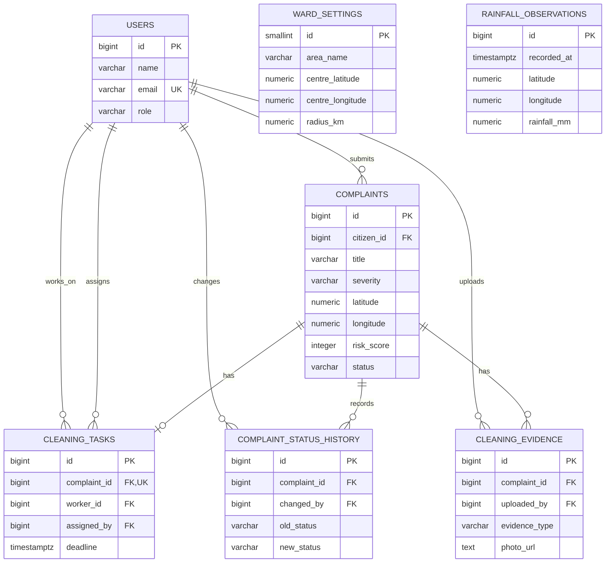

# DrainWatch ER Diagram

## Relationships

- One citizen can submit many complaints; each complaint belongs to one citizen.
- One complaint can have zero or one cleaning task in this project version.
- A worker can receive many cleaning tasks; each task is assigned by an authority user.
- One complaint can have many status-history records and many evidence photographs.
- Ward settings stores the single configured project area.
- Rainfall observations stores readings independently for later reporting.
